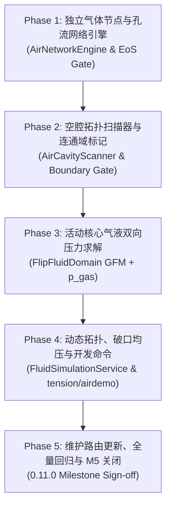

# Archived proposal: M5 空气区域网络与气液压力执行方案

> 本文是进入 M5 实施前的技术方案与执行计划，归档于 `docs/archive/proposals/`。实施阶段的系统契约以 [`../../architecture/fluid-solver.md`](../../architecture/fluid-solver.md) 为准，阶段总表以 [`../../roadmap/product-roadmap.md`](../../roadmap/product-roadmap.md) 为准，测试路由以 [`../../maintenance/routing.md`](../../maintenance/routing.md) 为准。

---

## 一、M5 目标与范围界定

### 1. 核心产品目标
1. **密闭空腔识别与气体状态**：在流体域中识别被固体壁面与液体自由面共同封闭的非连通空气腔室，为每个腔室分配独立的空气网络节点（Air Node），维护可用容积 $V_\text{avail}$、气体物质的量/质量库存 $n$，并由等温状态方程计算腔室表压 $p_\text{gas}$。
2. **开放大气边界**：外界大气作为容量无穷、表压恒为 $0$（即 $p_\text{atm}=0$）的特殊环境节点。凡是与域开边界连通或搜索超预算的区域，自动归类为环境大气。
3. **孔流与有限速率均压**：各密闭腔之间或腔与大气之间的开孔/缝隙抽象为连接边（Air Edge），按压差与孔口阻力进行有限速率的气体质量输运，杜绝瞬时均压或瞬时压力归零。
4. **气液双向压力求解**：
   - **液 $\to$ 气**：液体流入/压缩导致腔室 $V_\text{avail}$ 减小，气压 $p_\text{gas}$ 单调上升；
   - **气 $\to$ 液**：腔室气压直接作为该腔界面处液体的 Dirichlet 自由面边界条件：
     $$p_\text{interface} = p_\text{gas} + \sigma \kappa$$
     无缝接入 M4 的 Ghost-Fluid 压力跳跃算子，在泊松方程 RHS 与速度投影中保持平衡力闭合。
5. **气压物理现象呈现**：
   - 密闭注射器/活塞压缩回弹与阻尼稳定；
   - 倒扣密闭容器（钟罩）水柱悬挂（托里拆利/马德堡效应）；
   - U 型管两侧气压差维持重液体高度差（$\Delta p = \rho g \Delta h$）。

### 2. 必须坚守的架构红线
1. **物理真值与守恒绝对性**：
   - 液体真值仍由 marker `particleVolume` 与 `particleMass` 严格累加；
   - 气体真值由各节点的物质的量 $n$（或标准气体质量）持有；开孔、封孔、分裂、合并必须保证总气体物质的量严格守恒；
   - 严禁通过直接推拉 marker 坐标或渲染欺骗来伪造气压效果。
2. **平衡力离散与无额外寄生流**：
   - 气压 $p_\text{gas}$ 必须与表面张力 $\sigma \kappa$ 统一叠加在自由液面 Ghost-Fluid 跳跃条件中，严禁在 MAC 网格上施加非平衡外力导致高频数值寄生流。
3. **退化分支严格逐位一致**：
   - 当所有气相均为开放大气（$p_\text{gas} \equiv 0$）且 $\sigma = 0$ 时，活动求解器必须严格逐位（bit-for-bit）退化为 M3 纯水/多材料行为。
4. **Fail-Closed 与搜索预算约束**：
   - 拓扑搜索单次遍历受限于域边界或 512 BV 硬上限；一旦触及上限或未知状态，安全降级为环境大气，严禁全图无界漫延。
5. **协议与存档边界**：
   - M5 首版数据保持在内存与瞬态 demo；Wire 与 `region-state` 格式暂不变更，decode 默认按开放大气（$p_\text{gas}=0$）重建，确保当前 v2 状态无损 Round-Trip。

---

## 二、数学模型与数值离散设计

### 1. 状态方程与压力响应 (Equation of State)

在 M5 等温假定（参考温度 $T_0$）下，密闭腔室遵循理想气体状态方程：
$$p_\text{abs} V_\text{avail} = n R T_0$$
定义标准参考状态（环境大气压 $p_0 = 101.325\text{ kPa}$ 下单位体积空气的基准量），腔室的**表压**（Gauge Pressure，计算以模拟压强单位标定）离散计算公式为：
$$p_\text{gas} = p_0 \left( \frac{V_0}{V_\text{avail}} - 1.0 \right)$$
其中：
- $V_\text{avail} = \sum_{\text{cell}\in \text{Node}} \left( V_\text{open}(\text{cell}) - V_\text{liquid}(\text{cell}) \right)$ 为腔室内空气的真实可用体积；
- $V_0$ 为该腔室当前所含气体在标准环境压力下的等效体积（$V_0 \propto n$）；
- **数值正则化（防除零与防负压爆炸）**：
  为避免液体完全充满导致 $V_\text{avail} \to 0$ 产生无穷大奇异值，引入最小容积截断：
  $$V_\text{avail, safe} = \max(V_\text{avail}, \epsilon_V \cdot V_\text{total\_node}) \quad (\epsilon_V = 1.0 \times 10^{-3})$$
  $$p_\text{gas} = \text{clamp}(p_\text{gas}, -p_0 \cdot 0.99, p_\text{max\_safety})$$

### 2. 空腔拓扑识别 (Cavity Topology Detection)

在每个物理子步前或网格重建阶段：
1. **空气格定义**：$\text{isAir}(x,y,z) = (!\text{solid}[i] \ \&\&\ \text{markerCount}[i] == 0)$。
2. **连通分量标记（Flood Fill / BFS）**：
   - 在流体网格内部对所有空气格进行 6-邻域连通性搜索，标记出连通区域 $k$；
   - 若某连通分量触及计算域的外围开放边界（$x=0, x=X-1, y=Y-1$ 等未被 solid 封闭的边界），则该分量直接标记为 `AMBIENT`（环境大气，节点索引 0，固定 $p_\text{gas} = 0$）；
   - 若某连通分量完全被 solid 和含液体格（$\text{markerCount} > 0$）包围，则标记为独立的密闭 `CAVITY_k`。
3. **边界与部分充满格（Cut-cell Partial Fluid）**：
   - 含有液体的自由表面格，其空气余量 $V_\text{open} - V_\text{marker}$ 根据邻域空气连通性计入所属密闭腔室的可用体积中。

### 3. 双向压力耦合 Ghost-Fluid 离散 (Two-Way Pressure Coupling)

自由液面处的等效 Dirichlet 压力修正为腔室气压与曲率张力的叠加：
$$p_\text{interface}(i) = p_\text{gas}(\text{Node}(i)) + \sigma \kappa_i$$

1. **泊松方程 RHS 修正**：
   对于液体格 $i$ 面向空气格 $j$ 的开放面：
   $$u_\text{face} = u^*_\text{face} - \frac{\Delta t}{\rho \theta \Delta x} (p_\text{interface}(i) - p_i)$$
   在 `FlipFluidDomain` 构造散度时，自由面散度源项更新为：
   $$\text{div}_\text{boundary}(i) = -\sum_{\text{faces } f \in \text{Air}} A_f \frac{\Delta t}{\rho \theta \Delta x^2} p_\text{interface}(i)$$
2. **速度投影更新**：
   在 `projectVelocity` 中，液-气交界面的压力差使用同一 $p_\text{interface}(i)$：
   $$\Delta p = \frac{p_\text{interface}(i) - p_i}{\theta}$$
   $$\mathbf{u}^{n+1} = \mathbf{u}^* - \frac{\Delta t}{\rho \Delta x} \Delta p$$
   - **自洽性证明**：当流体静止且气液平衡时，$p_i = p_\text{gas} + \sigma \kappa$，使得 $\Delta p = 0$，投影后速度严格保持为 0，寄生流精确归零。

### 4. 孔流网络与阻尼输运 (Orifice Flow & Finite-Rate Equalization)

密闭腔 $A$ 与腔 $B$（或大气）之间存在开口截面积 $A_\text{hole}$ 时，采用标准孔口流量模型（NIST CONTAM 准则）：
$$Q_{AB} = C_d A_\text{hole} \cdot \text{sgn}(p_A - p_B) \sqrt{\frac{2 |p_A - p_B|}{\rho_\text{air}}}$$
在每个物理时间步 $\Delta t$ 内，两腔室转移的标准气体体积为：
$$\Delta V_{0} = \text{clamp}\left( Q_{AB} \cdot \Delta t, 0, 0.5 |V_{0,A} - V_{0,B}| \right)$$
$$V_{0, A} \leftarrow V_{0, A} - \Delta V_0, \quad V_{0, B} \leftarrow V_{0, B} + \Delta V_0$$
保证两腔在有限时间内平滑达到气压平衡，且总气体库存 $V_{0, A} + V_{0, B} \equiv \text{const}$。

---

## 三、分步实施计划与任务分解



### Phase 1: 独立气体节点与孔流网络引擎 (`com.example.fluid.air`)

#### 目标
创建无依赖的独立空气网络数据结构与物理积分器，验证状态方程、多节点气压计算、小孔流量阻尼与库存守恒。

#### 交付文件
- `[NEW] src/main/java/com/example/fluid/air/AirNode.java`
  - 记录节点 ID、是否为环境大气、当前可用体积 $V_\text{avail}$、基准气体量 $V_0$、当前计算表压 $p_\text{gas}$。
- `[NEW] src/main/java/com/example/fluid/air/AirEdge.java`
  - 记录连接的两个节点 ID、流通截面积 $A$、流量系数 $C_d$。
- `[NEW] src/main/java/com/example/fluid/air/AirNetwork.java`
  - 管理全部节点与边，提供 `step(dt)` 流量转移与 `recomputePressures()` 状态方程求解。
- `[NEW] src/test/java/com/example/fluid/AirNetworkValidation.java`
  - 验证：等温压缩 $p(V)$ 曲线、双腔小孔均压指数衰减、开孔封孔总 $V_0$ 绝对守恒。

#### 验收门禁
- 登记 Gradle 任务：`runAirNetworkValidation`。
- 断言：1000 步均压残差 $< 10^{-6}$，总气体库存误差 $\equiv 0.0$。

---

### Phase 2: 空腔拓扑扫描器与连通域标记 (`AirCavityScanner`)

#### 目标
在给定的 3D 网格（含 solid、liquid marker 分布）中，高效完成空气格连通性标记，识别密闭空腔与环境大气。

#### 交付文件
- `[NEW] src/main/java/com/example/fluid/air/AirCavityScanner.java`
  - 输入：`solid` 数组、`markerCount` 数组、`FlipCutCellGeometry`；
  - 输出：`int[] cellNodeId`（每格所属的空气节点 ID，0 为大气）、各节点统计的 $V_\text{avail}$；
  - 算法：基于 BFS / 队列的 3D Flood Fill，遇开边界立即染色为 0，单次扫描预算上限 512 BV。
- `[NEW] src/test/java/com/example/fluid/AirCavityScannerValidation.java`
  - 测试用例：
    1. 全开放水池：所有空气格染色为 0（大气）；
    2. 封闭带盖箱子（活塞腔）：内部空气染色为独立 Node 1；
    3. 开口 U 型管：两端空气均与大气连通，染色为 0；
    4. 封闭多隔离腔：正确识别出多个相互隔离的独立 Node ID。

#### 验收门禁
- 登记 Gradle 任务：`runAirCavityScannerValidation`。
- 断言：连通域拓扑判别 100% 正确，无数组越界或死循环。

---

### Phase 3: 活动核心气液双向压力耦合 (`FlipFluidDomain` 整合)

#### 目标
将气体网络与空腔扫描器接入 `FlipFluidDomain` 主循环，实现真实的气液机械压力双向交互。

#### 核心修改
1. **法向缓存与曲率重构**（响应此前代码审查的性能建议）：
   - 在 `FlipFluidDomain` 中引入 `normalFieldX, normalFieldY, normalFieldZ` 缓存数组；
   - 先一次遍历计算并正交化近壁法向，曲率散度计算直接读取邻域缓存，彻底消除 3 倍重复梯度差分。
2. **气压跳跃接入**：
   - 字段扩展：`private final float[] interfacePressure`；
   - 在 `rebuildSurfaceTensionPressure()` 中整合气压与张力：
     ```java
     int airNode = airCavityScanner.nodeAt(neighborX, neighborY, neighborZ);
     float gasPressure = airNetwork.pressureOf(airNode);
     interfacePressure[fluidCell] = gasPressure + (float)(sigma * kappa);
     ```
3. **泊松矩阵与投影**：
   - `surfaceTensionBoundaryDivergence` 升级为 `interfaceBoundaryDivergence`，统一消费 `interfacePressure`；
   - `projectVelocity` 中同样读取 `interfacePressure`。
4. **$p_\text{gas}=0$ 严格向后退化**：
   - 当所有节点为环境大气（$p_\text{gas}=0$）时，`interfacePressure` 严格等于原 `surfaceTensionPressure`，确保 M4 与 M3 逐位一致性。

#### 交付测试
- `[NEW] src/test/java/com/example/fluid/M5AirLiquidCouplingValidation.java`
  - **注射器活塞测试 (Piston Compression)**：水柱压缩密闭腔空气，水柱减速并在气压阻尼下达到静平衡，测得静平衡气压与解析解误差 $\le 2.0\%$；
  - **差压重液柱测试 (U-Tube Manometer)**：一端施加高压气体，另一端通大气，两侧液面高度差精确满足 $\Delta h = \frac{\Delta p}{\rho g}$（误差 $\le 3.0\%$）；
  - **闭室悬水测试 (Water Barometer)**：顶部密闭真空/微负压，底部开放，水柱在内外压差下克服重力保持悬挂不掉落；
  - **无持续寄生流与守恒**：平衡状态下最大粒子速度 $< 1.0\times 10^{-4}$，20 步 marker 总体积与质量绝对闭合。

#### 验收门禁
- 登记 Gradle 任务：`runM5AirLiquidCouplingValidation`。

---

### Phase 4: 动态拓扑、破口均压与 Minecraft 开发命令

#### 目标
处理游戏世界中方块打孔/封闭引起的拓扑突变，并提供可操作的实机视觉验证命令。

#### 核心修改
- `[MODIFY] src/main/java/com/example/simulation/FluidSimulationService.java`
  - 增加 `/realwater airdemo [piston|utube|barometer]` 瞬态开发命令，构造标准的气压验证场景。
- `[MODIFY] src/main/java/com/example/RealWaterCommands.java`
  - 注册 `airdemo` 命令。

---

### Phase 5: 维护路由更新、全量回归与 M5 关闭

#### 目标
完成全套回归测试，更新技术文档与版本号，正式关闭 M5 里程碑。

#### 交付清单
1. 更新 [`docs/maintenance/routing.md`](../../maintenance/routing.md)，登记 M5 相关测试门禁路由。
2. 更新 [`docs/architecture/fluid-solver.md`](../../architecture/fluid-solver.md)，补充 M5 生效的气压边界契约。
3. 创建 [`docs/progress/m5-air-network.md`](../../progress/m5-air-network.md)，记录全部验收数据与实机 Smoke 证据。
4. 版本推进至 `0.11.0`。

---

## 四、拟修改与新建文件清单 (Proposed Changes)

| 组件 / 层次 | 文件路径 | 变更类型 | 职责与变更简述 |
|---|---|:---:|---|
| **空气网络模型** | `src/main/java/com/example/fluid/air/AirNode.java` | `[NEW]` | 独立空气节点定义（可用容积、气体量、表压） |
| **空气网络模型** | `src/main/java/com/example/fluid/air/AirEdge.java` | `[NEW]` | 空气节点间流动阻力与孔口连接边 |
| **空气网络模型** | `src/main/java/com/example/fluid/air/AirNetwork.java` | `[NEW]` | 气体网络管理器、等温状态方程与孔流积分器 |
| **空腔拓扑扫描** | `src/main/java/com/example/fluid/air/AirCavityScanner.java` | `[NEW]` | 3D 网格空气连通域 Flood Fill 与大气连通性判定 |
| **活动求解核心** | `src/main/java/com/example/fluid/FlipFluidDomain.java` | `[MODIFY]` | 引入法向缓存优化，接入自由面 $p_\text{gas}+\sigma\kappa$ 双向压力边界 |
| **Minecraft 服务** | `src/main/java/com/example/simulation/FluidSimulationService.java` | `[MODIFY]` | 支持瞬态气压开发域构造与调度适配 |
| **命令系统** | `src/main/java/com/example/RealWaterCommands.java` | `[MODIFY]` | 注册 `/realwater airdemo` 测试命令 |
| **测试套件** | `src/test/java/com/example/fluid/AirNetworkValidation.java` | `[NEW]` | 独立气体网络状态方程与均压阻尼回归门 |
| **测试套件** | `src/test/java/com/example/fluid/AirCavityScannerValidation.java` | `[NEW]` | 独立空腔拓扑识别与开闭边界判别门 |
| **测试套件** | `src/test/java/com/example/fluid/M5AirLiquidCouplingValidation.java` | `[NEW]` | 活动求解器活塞压缩、U 型管高度差与悬水物理门 |
| **工程配置** | `build.gradle` | `[MODIFY]` | 注册 M5 新增的 3 个 JavaExec 定向验证任务 |
| **维护路由** | `docs/maintenance/routing.md` | `[MODIFY]` | 登记 M5 改动对应的默认验证任务与升级规则 |
| **架构文档** | `docs/architecture/fluid-solver.md` | `[MODIFY]` | 固化 M5 气液自由面压力跳跃与气体网络契约 |
| **版本记录** | `gradle.properties`, `docs/progress/` | `[MODIFY]` | 升级版本号至 0.11.0 并归档 M5 进度记录 |

---

## 五、验证计划 (Verification Plan)

### 1. 自动化测试阶梯 (Automated Gates)

```powershell
$env:JAVA_HOME = 'D:\ProgramFiles\BienCreng\jdk-26.0.2'
$env:Path = "$env:JAVA_HOME\bin;$env:Path"

# Phase 1: 独立气体网络方程与孔流阻尼门
./gradlew.bat runAirNetworkValidation --offline

# Phase 2: 独立空腔拓扑扫描与环境边界门
./gradlew.bat runAirCavityScannerValidation --offline

# Phase 3: 活动求解器气液耦合物理门 (活塞压缩、U型管差压、倒扣悬水、无寄生流与守恒)
./gradlew.bat runM5AirLiquidCouplingValidation --offline

# Phase 5: M0~M4 全量防回归基线
./gradlew.bat runM4SurfaceTensionValidation runM3ConnectedVesselValidation runFlipFreeSurfaceValidation runFluidRegionPersistenceValidation --offline
```

### 2. 核心数值硬门禁指标 (Acceptance Criteria)

1. **等温压缩精度**：活塞腔室可用容积压缩至 $50\%$ 时，静平衡实测表压与理论解 $p = p_0$ 相对误差 $\le 2.0\%$。
2. **U 型管差压高度**：施加 $\Delta p$ 时，水柱高度差 $\Delta h$ 满足 $\Delta h = \frac{\Delta p}{\rho g}$，相对误差 $\le 3.0\%$。
3. **有限孔流均压衰减**：双腔连通后气压差呈现经典指数平滑衰减，无高频振荡，且全过程系统总气体物质的量 $\Delta n \equiv 0.0$。
4. **无持续寄生流**：气液平衡稳定后，体系最大粒子寄生速度 $\|u\| \le 1.0\times 10^{-4}$。
5. **完全向后退化**：在开放大气下（$p_\text{gas}=0$），求解器与 M4 零气压行为逐位完全一致（`floatToRawIntBits` 对比通过）。

### 3. 实机人工 Smoke 验证 (In-Game Visual Smoke)
- 使用 `/realwater airdemo piston`：观察水柱推入密闭腔室后受气压阻滞停止并稳定在平衡位置；
- 使用 `/realwater airdemo utube`：观察高压腔一侧水面被压低、大气侧水面抬高并保持稳定水头差。
