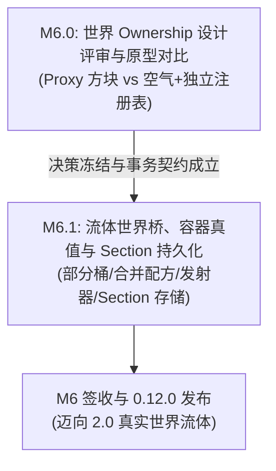
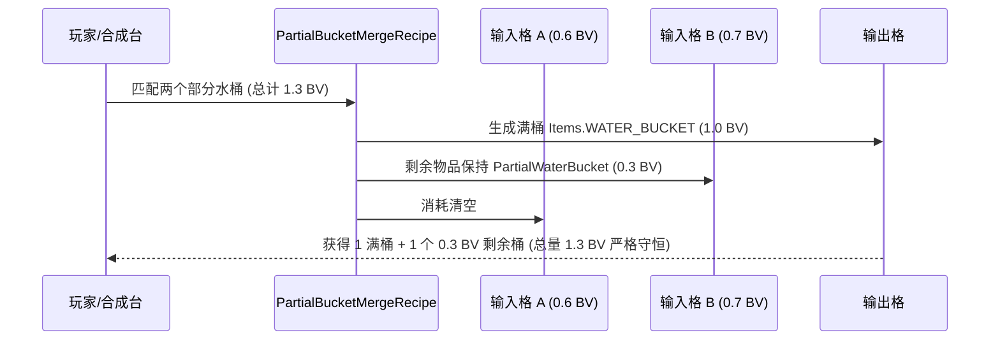
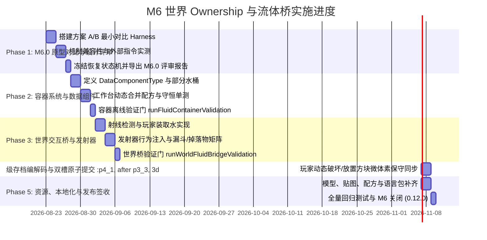

# Proposal: M6 世界 Ownership 与流体桥执行方案 (M6 World Ownership & Fluid Bridge Execution Plan)

> 本文是进入 Milestone 6（M6：世界 ownership 与流体桥）实施前的详细技术设计方案与执行计划，归档于 `docs/archive/proposals/m6-gemini-plan.md`。
> 实施阶段的系统契约以 [`../../architecture/fluid-solver.md`](../../architecture/fluid-solver.md) 和 [`../../architecture/region-state-v1.md`](../../architecture/region-state-v1.md) 为准，产品总表以 [`../../roadmap/product-roadmap.md`](../../roadmap/product-roadmap.md) 为准，维护路由以 [`../../maintenance/routing.md`](../../maintenance/routing.md) 为准。

---

## 一、M6 目标与范围界定

### 1. 阶段定位与核心产品目标
M6 是 Real Water 从“独立有界求解器（M0~M5）”跨越到“真实 Minecraft 世界集成与世界桥（1.0 $\to$ 2.0 过渡）”的关键里程碑。核心目标分为两个强依赖子阶段：



1. **M6.0: 世界 Ownership 设计评审与原型对比**
   - 解决核心矛盾：当 Real Water 在某空间模拟水流时，Minecraft `Level` / `Chunk` 中该方块坐标以何种形态存在？
   - 构建可丢弃的最小原型，对比评估：
     - **方案 A（代理占位方块 Proxy Block）**：使用专用轻量方块（如 `realwater:fluid_proxy`）占位；
     - **方案 B（空气 + 独立空间注册表 Air + Standalone Spatial Registry）**：世界中保持 `Blocks.AIR`，由服务端空间注册表与 Chunk 加载钩子维护管理权。
   - 冻结共同代次与崩溃恢复状态机（`ownership`、`region-state`、原版方块替换与解除接管共享区域 UUID 与 commit generation）。
   - **硬性红线**：未完成 M6.0 的对比实验、风险论证与评审，**严禁**直接进入 M6.1 代码落地。

2. **M6.1: 流体世界桥、容器真值与游戏集成**
   - **容器水量物理真值**：
     - 标准桶容量为 $1\text{ BV} = 1.0\text{ m}^3 = 1000\text{ L}$（对应 $0.5\text{ m}$ 尺度下的 8 个求解器格）。
     - 满纯原版水退化为标准 `Items.WATER_BUCKET`；
     - 部分纯水由专用数据组件（`realwater:fluid_volume`）精确记账，**严禁**使用 Minecraft 物品 damage 充当物理水量；
     - 多材料（油/水银/混合液）容器记录体积与材料/相 handle。
   - **容器动态合成与溢出守恒**：
     - 工作台合并两个部分水桶时，原子填满一个，多余水量通过动态配方剩余物品（`getRecipeRemainder`）保留在副桶中，实现总量绝对守恒。
   - **世界装取与交互矩阵**：
     - 玩家准星舀水（drain）与注水（pour）；
     - 发射器（Dispenser）舀水/注水行为与模拟区账本协调；
     - 漏斗、掉落物、死亡掉落、创造模式源汇分类记账；
     - 非协商外部 Mod 传输一律拒绝，严禁臆测体积语义。
   - **Section 分片持久化与世界碰撞动态同步**：
     - 区域存储向 Chunk Section 粒度分片（`section_<x>_<y>_<z>.nbt`）过渡；
     - 玩家在流体域内放置/破坏方块时，世界交互层进行 $4\times 4\times 4$ 微体素保守重新采样，动态更新 cut-cell，防止流体穿墙或凭空丢失。

### 2. 必须坚守的架构红线
1. **物理真值绝对性**：
   - 域内水量真值唯一来自 marker `particleVolume` 精确和；
   - 容器水量真值唯一来自 ItemStack 数据组件中的 `double` / `long` 纳体积，渲染 density、界面分数、物品耐久度均不得成为真值。
2. **世界事务与零静默覆盖**：
   - 修改 Minecraft 世界方块前必须先落盘原子 Journal 与 WARNING 状态；
   - 恢复过程绝对不得覆盖玩家新放置的实体方块；
   - 状态损坏、失配或超预算时必须保持暂停并显式报警，严禁静默丢弃。
3. **不可部分加载步进 (No Half-Region Stepping)**：
   - 跨 Chunk 区域是原子生命周期单元；若任一关联 Chunk 未加载，整域必须进入暂停或 `UNLOADED`，严禁把未加载 Chunk 当作虚空实心墙继续半步进。
4. **多材料与多相隔离**：
   - 非纯水材料（如油、水银）不得退化为原版水桶；未开启 `materialsEnabled` 门时，世界桥仅允许纯水输入输出。
5. **游戏资源完整性**：
   - 任何正式 Gameplay 入口（方块、物品、配方、指令）必须同步交付模型、贴图、语言包（`zh_cn` / `en_us`）、Tooltip 与音效，缺少资源视为未完成。

### 3. 非目标 (Non-Goals)
- **近期不做**：
  - 无界开放世界海洋/全图河流 20Hz 实时接管（留待 2.0+ 宏观休眠与多后端就绪后）；
  - 化学反应网络（M7）、低成本颗粒/泥沙沉积（M8）、温度与非等温相变（M9）；
  - 对未提供 API 契约的第三方流体 Mod 进行模糊推断或强制兼容。

---

## 二、M6.0 世界 Ownership 方案对比与设计评审

### 1. 两条候选方案的深度对比矩阵

| 评估维度 | 方案 A：代理占位方块 (`realwater:fluid_proxy`) | 方案 B：空气 + 独立空间注册表 (`AIR` + Spatial Registry) |
|---|---|---|
| **原版流体 Tick 与扩散** | **优**：Proxy 属于非空气实体方块，原版水/岩浆天然不会向其扩散侵占。 | **劣**：世界中为 `AIR`，相邻原版水会尝试向内流动生成水流方块，需要高频 Mixin 拦截 `FluidState.getAmount()`。 |
| **玩家放置与破坏方块** | **中**：玩家右击 Proxy 时，若手持方块需拦截 `use` 逻辑替换 Proxy 为实体方块并挤出内部水；左击破坏需瞬时吸收或回弹。 | **优**：玩家在空气中自然放置方块，触发常规 `BlockEvents.AFTER_PLACE`，流体只需在下一步保守重采样世界碰撞并挤压 marker。 |
| **光照、寻路与渲染** | **中**：Proxy 必须声明 `noCollision`、全透光、空渲染模型，否则会导致光照计算变暗、怪物寻路绕行。 | **优**：原版世界本身就是 `AIR`，光照、怪物寻路和视线检测天然完全兼容原版。 |
| **活塞、爆炸与结构命令** | **劣**：活塞可能推走 Proxy 方块，爆炸可能将 Proxy 炸毁掉落空气，`/clone` 会把 Proxy 复制到未管理区域引发虚假模拟。 | **优**：活塞推入方块直接变为流体域的新固相；爆炸清空方块后变为流体可用空间；结构命令无需处理非标准方块。 |
| **外部方块编辑与 Chunk 异步保存** | **中**：WorldEdit 等外部工具会保存并替换 Proxy 方块，容易造成 Proxy 残留在无求解器区域。 | **优**：外部工具只看到空气和普通实体方块，save file 中无外来方块污染。 |
| **Mod 管道与抽取兼容性** | **优**：Proxy 可实现标准 Fluid Block 接口或挂载 BlockEntity，方便常规工业 Mod 管道探测与抽水。 | **劣**：需要提供额外的区域端口（Region Port Block）供外部 Mod 管道连接，无法直接在水流任意处抽水。 |
| **Mod 卸载与崩溃恢复** | **劣**：若玩家在存在 Proxy 时直接移除 Mod，世界中将残留大量 Missing Block / 错误红黑紫方块。 | **优**：Mod 卸载后世界中全为原版 `AIR` 和普通方块，不产生任何未知方块 ID 污染。 |
| **内存与 Chunk 保存体积** | **中**：每个水方块在 chunk subchunk 的 block palette 中增加一项，轻微增加 chunk 磁盘大小。 | **优**：空气方块使用原版全局单例，chunk 保存开销为零。 |

### 2. M6.0 评审决策标准与推荐路线

> **评审结论与建议路线**：
> **推荐采用方案 B（空气 + 独立空间注册表），并在控制器/边界提供显式的 `FluidPortBlock` 作为第三方管道接入点。**
> 
> **理由**：
> 1. Real Water 物理分辨率为 $0.5\text{ m}$（每方块 $2\times 2\times 2 = 8$ 格）并支持亚格自由液面。1 格方块可能同时存在水、油和空气，单个 1x1x1 Proxy 方块无法表达内部丰富的多相几何与连续液面。
> 2. 方案 B 在 Mod 卸载、世界崩溃、外部命令（`/clone`、WorldEdit）和光照/寻路上具备极强的鲁棒性，世界保存永远是干净的原版方块。
> 3. 控制器区域已具备显式外壳，原版水不会自然侵入内部；外部环境的接管仍由 M0 的原子 Journal 保障。

### 3. 共同代次与恢复状态机 (Joint Commit State Machine)

无论最终选择何种路线，必须建立统一的事务协调器 `WorldOwnershipCoordinator`：

```text
[World Block State] <== Atomic Commit Epoch ==> [Region-State v2/v3]
                              |
                     TakeoverJournal / WARNING
                              |
                    [Quarantine & Recovery]
```

- **统一代次 ID**：每次世界方块变动（Takeover 移除水、恢复原版水、控制器激活、持久化保存）生成单调递增的 `commitEpoch`（与 region UUID 绑定）。
- **Fail-Closed 校验**：加载时对比世界方块快照校验和与 `region-state` manifest 中的 `worldHash`。若发现玩家在离线时使用外部编辑器在水域放置了实体方块：
  - 自动保留玩家新放置的实体方块；
  - 触发保守重新采样（Conservative Resample）；
  - 挤压受影响的 marker 转移至邻近自由空间，若空间不足则记入溢出账本并暂停域，绝不覆盖玩家方块。

---

## 三、M6.1 流体桥与容器系统架构

### 1. 容器数据组件与物理真值定义

在 Minecraft 26.2 / Fabric API 中，摒弃旧版 NBT 字符串猜测，全面采用静态类型化的 **`DataComponentType`**：

```java
// 核心数据组件注册 (com.example.item.RealWaterComponents)
public static final DataComponentType<FluidVolumeComponent> FLUID_VOLUME;
public static final DataComponentType<FluidMaterialComponent> FLUID_MATERIAL;

public record FluidVolumeComponent(long volumeNanos) {
    public static final long BUCKET_CAPACITY_NANOS = 1_000_000_000L; // 1 BV = 1.0 m³
    public double cubicMeters() { return volumeNanos * 1.0E-9; }
    public float fillFraction() { return (float) ((double) volumeNanos / BUCKET_CAPACITY_NANOS); }
}

public record FluidMaterialComponent(Identifier materialId, int phaseLabel) {
    public static final Identifier PURE_WATER = Identifier.fromNamespaceAndPath("realwater", "water");
}
```

- **物品类型定义**：
  1. `PartialWaterBucketItem`（`realwater:partial_water_bucket`）：
     - 携带 `FLUID_VOLUME` 组件（$0 < \text{volume} < 1.0\text{ BV}$）；
     - 最大堆叠数（`maxStackSize`）强制为 1；
     - 物品耐久度条（Durability Bar）仅用作**只读客户端展示**：
       $$\text{BarWidth} = \text{round}(13.0 \times \text{fillFraction})$$
       颜色渐变呈现水体清澈度，但内部结算只读 `volumeNanos`。
  2. `PartialMaterialContainerItem`（`realwater:material_container`）：
     - 携带 `FLUID_VOLUME` 与 `FLUID_MATERIAL` 组件；
     - 对应非纯水（如油、水银、未来化学混合物），材质颜色从注册表动态染色。
  3. **退化规则**：
     - 当部分纯水桶水量通过合并或装水恰好达到 $1.0\text{ BV} = 10^9\text{ nanos}$ 时，原子退化替换为原版 `Items.WATER_BUCKET`；
     - 当原版水桶在 Real Water 模拟区内使用并被舀取部分水量后，原子替换为 `realwater:partial_water_bucket`。

### 2. 工作台动态合并配方 (Dynamic Merging Recipe)

两个部分水桶放入工作台（Crafting Grid）时，触发动态无序配方 `PartialBucketMergeRecipe`：



- **配方守恒规则**：
  - 输入总水量 $V_\text{sum} = V_A + V_B$；
  - 若 $V_\text{sum} \le 1.0\text{ BV}$：输出格产生一个 $V_\text{sum}$ 的部分水桶，两个输入格均返回空桶 `Items.BUCKET`；
  - 若 $V_\text{sum} > 1.0\text{ BV}$：输出格产生满水桶（$1.0\text{ BV}$），主输入格消耗，副输入格通过 `getRemainingItems(CraftingInput)` 返回携带 $V_\text{sum} - 1.0\text{ BV}$ 的副桶。
  - **绝无水分丢失，绝无水分复制**。

### 3. 世界交互：玩家与发射器装取/注水 (Scoop & Pour)

```text
玩家右键点击流体表面/空腔:
  1. 视线光线步进（Raycast），以 0.5m 求解器网格精度定位相交的流体格 (x, y, z)；
  2. 校验该流体域所属 FluidRegion 是否处于活跃/已加载状态；
  3. 若手持空桶/部分桶（Scoop 舀水）：
     - 计算需求量 deltaV = min(可容纳量, containingCellMarkerVolume);
     - 求解器按物理真值删除对应数量的 marker（优先移除命中格顶部 marker，保持体积和精确闭合）；
     - 物品组件增加 deltaV；若恰好满桶则退化为 Items.WATER_BUCKET；
     - 触发 P2G 网格标脏并重新求解压力。
  4. 若手持满桶/部分桶（Pour 注水）：
     - 校验命中点上方是否有足够开放空间（!isSolid && markerCount < 上限）；
     - 求解器在对应坐标播种精确体积的 marker（单格最多 8 颗，总 particleVolume 等于注入量）；
     - 物品扣除相应水量（若清空则退化为 Items.BUCKET）；
     - 触发网格与气体网络重扫。
```

- **发射器行为 (`DispenserBlock.registerBehavior`)**：
  - 在发射器正前方 1 格空间进行采样；
  - 遇到 Real Water 模拟域时，优先与模拟区进行水量交换；
  - 成功舀水后将满桶或部分桶返还至发射器内部容器槽，若槽满则弹出掉落物；
  - 遇到非 Real Water 区域时，严格保持原版发射器行为不变。

### 4. Chunk Section 分片持久化架构

为了支持开放世界扩张，持久化存储结构从“整个长方体区域”升级为“按 Chunk Section（$16\times 16\times 16$ 方块）分片”：

```text
<world>/realwater/region-state/
  <region-uuid>/
    HEAD.nbt                   <-- 唯一原子提交点 (含全局 commitEpoch、所有 active section 清单与校验和)
    slot-a/
      manifest.nbt             <-- 区域总账本与元数据
      section_0_4_-1.nbt       <-- 局部 Section 0, 64~79, -16~-1 的流体切片
      section_0_4_0.nbt        <-- 局部 Section 0, 64~79, 0~15 的流体切片
    slot-b/
      ...
```

- **Section 切片内容 (`section_<x>_<y>_<z>.nbt`)**：
  1. FormatVersion & Region UUID & Commit Generation；
  2. Chunk Section 空间坐标 $(cx, cy, cz)$；
  3. 本 Section 内的所有 Marker 数据（扁平 float 数组：位置、速度、`particleVolume`、材料/相 handle、质量）；
  4. 本 Section 的 Solid occupancy 掩码（微体素切片）；
  5. 本 Section 的气体节点局部片段与跨 Section 边界连接；
  6. CRC32 校验和。
- **原子提交协议**：
  - 只有当所有包含流体的 Section 均写入临时目录并自检成功后，才原子重命名 slot 并切换 HEAD。
  - 跨 Chunk 卸载时，只要该区域还有至少一个 Section 处于活动视距内，就由 Manager 维护整体生命周期；全域离开视距时，原子持久化并转入 `UNLOADED` 状态，释放求解器内存。

---

## 四、分阶段执行路线图与任务分解



### Phase 1: M6.0 原型对比与设计评审 (Design Review & State Machine)
- **任务目标**：完成方案 A（Proxy 方块）与方案 B（空气 + 注册表）的最小实现测试对比，形成正式评审文档，冻结恢复状态机。
- **具体工作**：
  1. 在 `src/test/java/com/example/simulation/ownership/` 下编写独立测试框架；
  2. 模拟方块放置、破坏、活塞推动、爆炸、`/clone`、外部 WorldEdit 编辑、崩溃恢复 7 种边界；
  3. 编写 `docs/progress/m6.0-ownership-review.md`，记录客观证据并正式选定主干路线；
  4. 实现 `WorldOwnershipCoordinator` 状态机原型，确立区域 UUID 与 commit generation 联动。
- **交付物**：`m6.0-ownership-review.md` 评审文档、`runOwnershipPrototypeValidation` 独立测试门。

### Phase 2: 容器系统与数据组件 (Containers & Components)
- **任务目标**：建立绝对守恒的容器系统，支持部分水、多材料容器与工作台无损合并。
- **具体工作**：
  1. 注册 `realwater:fluid_volume` 与 `realwater:fluid_material` 数据组件（Java Record）；
  2. 实现 `PartialWaterBucketItem` 与 `PartialMaterialContainerItem` 类，绑定耐久条渲染；
  3. 编写 `PartialBucketMergeRecipe` 动态合成配方，覆盖 2 桶、3 桶合并以及带余量返回；
  4. 编写 `runFluidContainerValidation`，穷举测试从 $1\text{ nano}$ 到 $1\text{ BV}$ 的合并、拆分、数据组件序列化 round-trip。
- **交付物**：容器类、合成配方类、`runFluidContainerValidation` 门。

### Phase 3: 世界交互桥与发射器 (Player & Dispenser Bridge)
- **任务目标**：打通玩家与机械方块对 Real Water 模拟水体的装取与注入。
- **具体工作**：
  1. 在 `FluidRegionWorldInteraction` 中实现 `raycastFluidCell` 与 `drainFromWorld` / `pourIntoWorld`；
  2. 严格按 marker 账本结算水量，注入时进行 $0.5\text{ m}$ 格内 8-marker 规则播种，舀取时精确删除等体积 marker；
  3. 注册发射器自定义行为（`DispenserBlock.registerBehavior`），与模拟区事务协同；
  4. 覆盖掉落物、漏斗传输、死亡掉落以及创造模式（创造模式标记为外部源汇并在 debug 中单独统计）。
- **交付物**：世界装取逻辑、发射器钩子、`runWorldFluidBridgeValidation` 门。

### Phase 4: Section 分片持久化与动态碰撞 (Section Persistence & Dynamic Cut-Cells)
- **任务目标**：实现 Chunk Section 粒度的分片持久化与实时的世界方块编辑保守同步。
- **具体工作**：
  1. 实现 `SectionStateCodec` 与 `SectionDescriptor`，支持 `section_<x>_<y>_<z>.nbt` 分片保存；
  2. 扩展双槽原子提交协议（`slot-a` / `slot-b` / `HEAD.nbt`），单 Section 损坏不污染其他 Section；
  3. 挂接方块更新事件：当玩家在流体域内放置或破坏方块时，局部标记 solid mask 脏，下一子步前由 `FluidRegionWorldInteraction` 重新采样 $4\times 4\times 4$ 微体素并更新 `FlipCutCellGeometry`；
  4. 验证挤水逻辑：当实体方块压入含流体格时，流体 marker 被法向推开至相邻可用格，空间不足时如实记入溢出账本。
- **交付物**：Section 存储引擎、微体素动态同步、`runSectionPersistenceValidation` 门。

### Phase 5: 游戏资源、本地化与发布签收 (Assets, i18n & Release)
- **任务目标**：补齐所有用户可见资源，执行全量自动化与实机回归，签收 M6 并发布 `0.12.0`。
- **具体工作**：
  1. 添加物品模型 JSON (`assets/realwater/models/item/...`)、纹理 PNG、创造模式物品栏注入；
  2. 完善语言文件 `assets/realwater/lang/zh_cn.json` 与 `en_us.json`（包含物品名、tooltip、命令提示与失败报错）；
  3. 更新维护路由 [`docs/maintenance/routing.md`](../../maintenance/routing.md) 与架构契约；
  4. 执行 M0~M6 全量测试门；
  5. 产出 M6 验收报告 `docs/progress/m6-world-integration.md`，提交 git 并升级版本至 `0.12.0`。
- **交付物**：全部资源文件、验收报告、`0.12.0` 版本发布。

---

## 五、测试阶梯与最小充分验证路由

遵循项目的 KISS 与定向门原则，每个开发阶段只执行最贴近的一项 Gradle 门：

```powershell
# 环境变量配置
$env:JAVA_HOME = 'D:\ProgramFiles\BienCreng\jdk-26.0.2'
$env:Path = "$env:JAVA_HOME\bin;$env:Path"

# Phase 1: M6.0 Ownership 对比验证门
./gradlew.bat runOwnershipPrototypeValidation --offline --no-daemon

# Phase 2: 容器水量物理真值与合成合并门
./gradlew.bat runFluidContainerValidation --offline --no-daemon

# Phase 3: 玩家与发射器世界装取水交互门
./gradlew.bat runWorldFluidBridgeValidation --offline --no-daemon

# Phase 4: Chunk Section 分片持久化与故障注入门
./gradlew.bat runSectionPersistenceValidation --offline --no-daemon

# Phase 5: 里程碑关闭前的跨阶段全量回归汇总门 (签收时一次性运行)
./gradlew.bat runM5GasLiquidCouplingValidation runM4SurfaceTensionValidation runM3ConnectedVesselValidation runFlipFreeSurfaceValidation runFluidNetworkProtocolValidation runTakeoverJournalValidation runFluidRegionPersistenceValidation --offline --no-daemon
```

### 验证标准汇总

| 验证项 | 核心判定标准 |
|---|---|
| **容器合并守恒** | 100,000 次随机体积合并测试中，输入总纳体积与输出总纳体积绝对误差为 **0**。 |
| **装取水物理守恒** | 连续 50 次舀水与注水循环后，求解器总 `particleVolume` 与容器内水量的和保持不变。 |
| **Section 故障注入** | 在写入 Section 任意阶段强行中断（Kill/Exception），重启后必为严格的前代或完整的新代，绝无半加载状态。 |
| **玩家方块安全** | 在包含流体的区域内通过 `/setblock` 放置钻石块，重启并恢复后钻石块完好无损，流体避让或暂停。 |
| **M0~M5 零回归** | 气液耦合误差 $\le 8\%$，表面张力 Laplace 跳跃误差 $\le 2\%$，连通器均面正常，协议解析无损。 |

---

## 六、给后续执行 AI 的特别警示与避坑指南 (Senior Reviewer Warnings)

在实施 M6 过程中，请后续执行 AI 务必牢记以下核心禁忌：

> [!CAUTION]
> ### 1. 严禁用物品 Damage 充当物理水量
> Minecraft 物品的 Damage 字段受限于客户端显示与整数截断，且易受铁砧修复、创造模式或外部 Mod 修改。**必须**使用自定义 `DataComponentType<FluidVolumeComponent>` 存储精确的 `long volumeNanos`。Damage 仅作只读表现层！

> [!WARNING]
> ### 2. 严禁半区域加载步进 (No Partial Stepping)
> 跨 Chunk 区域如果部分 Chunk 被卸载，**绝对不能**把未加载边界当成实心墙继续跑物理，否则水流会在虚假边界处撞击堆积，等 Chunk 加载后发生体积爆炸。必须暂停整域或进入 `UNLOADED`。

> [!IMPORTANT]
> ### 3. 动态方块更新必须使用保守采样 (Conservative Voxelization)
> 玩家在水流中放置一个栅栏、楼梯或半砖（非完整方块）时，必须通过 `FluidRegionWorldInteraction` 的 $4\times 4\times 4$ 微体素保守采样写入 cut-cell。严禁用简单的 `isSolid()` 二值判定，否则会导致水体大面积穿透非完整方块。

> [!NOTE]
> ### 4. 多材料绝对不得退化为原版水桶
> 只有当材料注册表确认是纯水（`realwater:water`）且水量恰好为 $1.0\text{ BV}$ 时才允许退化为 `Items.WATER_BUCKET`。油、水银或未来化学混合物必须严格保留在 `realwater:material_container` 中，严禁让原版水桶装载非水液体导致世界生成假水。

---

## 七、总结与交付检查单

执行 M6 时，严格遵循以下交付步骤：

- [ ] **M6.0 评审就绪**：完成两种 Ownership 方案对比并归档 `docs/progress/m6.0-ownership-review.md`。
- [ ] **数据组件注册**：完成 `FluidVolumeComponent` 与 `FluidMaterialComponent`。
- [ ] **部分水桶与容器**：实现 `PartialWaterBucketItem` 与动态合成合并配方。
- [ ] **世界装取桥接**：实现玩家准星 Raycast 与发射器装取注水。
- [ ] **Section 分片存储**：完成 `SectionStateCodec` 与双槽原子提交。
- [ ] **资源与本地化**：交付模型、贴图、`zh_cn.json` 与 `en_us.json`。
- [ ] **维护路由同步**：更新 `docs/maintenance/routing.md` 中的代码职责与定向门。
- [ ] **全量回归验证**：所有 Gradle 门与 GameTest 测试全部通过。
- [ ] **里程碑签收**：产出 `docs/progress/m6-world-integration.md`，版本号提升至 `0.12.0`。
